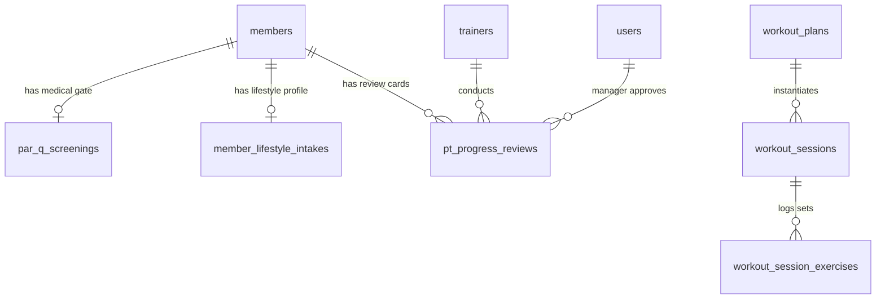

# Plan: PT Client File Digitization & Missing Fields Integration

Tasks register: [TASKS.md](./TASKS.md)  
Source Document: [Luxe knox pt client  file.pdf](./Luxe%20knox%20pt%20client%20%20file.pdf) (10 pages)  
Extracted Markdown: [Luxe knox pt client  file.md](./Luxe%20knox%20pt%20client%20%20file.md)  

---

## 1. Context

The Luxe Knox Personal Training Client File is a 10-page paper dossier that tracks a PT client across their entire lifecycle (Intake $\rightarrow$ Health Screening $\rightarrow$ Assessment $\rightarrow$ Program Design $\rightarrow$ Workout Execution $\rightarrow$ Session Logging $\rightarrow$ Progress Review $\rightarrow$ Package Management $\rightarrow$ End-of-Cycle Sign-off).

An audit of the paper dossier against the current codebase ([`database-entities.md`](../../database-entities.md) and [`backend-frd.md`](../../backend-frd.md)) revealed critical missing fields and workflow gaps:
1. **PAR-Q+ 7 questions & legal health screening gate** (Page 2): No discrete questionnaire or medical clearance workflow.
2. **Lifestyle & Wellness Intake** (Page 3): Missing activity level, training history, sleep, stress (1–10), work demands, steps, recovery habits, and the 4-Quadrant Priorities Matrix (Sleep, Nutrition, Daily Activity, Recovery with "Current Status" and "First Action").
3. **Macrocycle Program Design & Member Preferences** (Pages 1 & 5): Missing 12-week primary objective, 4-week milestone, frequency, session duration, split type, progression levers, qualitative goal tags, next review date, and movement preferences.
4. **Workout Micro-Execution & Safety** (Pages 6 & 7): Missing Reps In Reserve (RIR), timed duration sets, warm-up/cool-down protocols, granular multi-dimensional session ratings (Effort 1–10, Satisfaction 1–10, Pain/Discomfort 0–10 with early-warning safety alert), and next-session planning.
5. **Progress Review & Presentation Card** (Pages 8 & 10): Missing review date range, start/current/change/target delta table, celebration badges, 6-point review checklist, next phase roadmap, and tri-party sign-off (Client $\rightarrow$ Trainer $\rightarrow$ Manager).
6. **Trainer Continuity & Client Attendance Verification** (Page 9): Missing coaching handover notes during trainer reassignments and client-side session attendance sign-off.

---

## 2. Architecture & Design

### 2.1 Database Entities & Schema Strategy

The schema is modified cleanly using Drizzle ORM in `apps/api`:

1. **`par_q_screenings` (New Table)**:
   * Holds the 7 discrete standard PAR-Q+ questions (`boolean` + `details text`).
   * Computes `has_positive_answer` and tracks `clearance_status` (`'passed'`, `'pending_clearance'`, `'cleared'`, `'rejected'`).
   * Stores `trainer_screening_notes`, `referral_required`, `declaration_accepted`, `client_signed_at`, and `cleared_by_user_id`.
2. **`member_lifestyle_intakes` (New Table)**:
   * 1-to-1 extension of `members` storing `activity_level`, `training_history`, `current_pain_discomfort`, `sleep_hours_typical`, `stress_level` (1–10), `work_activity_demands`, `typical_daily_steps`, `hydration_habits`, `recovery_habits`, and `lifestyle_priorities` JSON array (Sleep, Nutrition, Activity, Recovery).
3. **`workout_plans` (Altered Table)**:
   * Adds `primary_objective_12w`, `milestone_4w`, `sessions_per_week`, `target_session_duration_minutes`, `split_type`, `cardio_protocol`, `mobility_protocol`, `progression_methods` JSON array (`load`, `reps`, `volume`, `density`, `technique`), and `main_success_measure`.
4. **`workout_plan_exercises` & `workout_session_exercises` (Altered Tables)**:
   * Adds `target_rir`, `actual_rir`, `target_duration_seconds`, `actual_duration_seconds` (for timed holds), and `notes`.
5. **`workout_sessions` (Altered Table)**:
   * Adds `session_focus`, `warmup_protocol`, `cooldown_protocol`, `effort_rating` (1–10), `satisfaction_rating` (1–10), `pain_discomfort_score` (0–10), `pain_notes`, `next_session_plan`, and dual signatures `client_signed_at` & `trainer_signed_at`.
6. **`pt_progress_reviews` (New Table — Backing Screen 47)**:
   * Tracks formal periodic reviews: `member_id`, `trainer_id`, `review_period_start`, `review_period_end`, `body_metrics_snapshot` JSON, `performance_markers_snapshot` JSON, `progress_highlights` JSON array, `trainer_summary`, `client_feedback`, `next_phase_goal`, `next_phase_training_focus`, `next_review_date`, `review_checklist` JSON, `final_review_notes`, and 3 sign-offs (`client_signed_at`, `trainer_signed_at`, `manager_signed_at`).
7. **`members` & `pt_subscription_changes` (Altered Tables)**:
   * `members`: Adds `next_review_date`, `preferred_training_days_times`, `exercise_preferences`, and `coaching_notes`.
   * `pt_subscription_changes`: Adds `handover_continuity_notes`.
   * `schedule_participants`: Adds `client_verified_at`.

---

## 3. Backend Implementation (`apps/api`)

### 3.1 Health & Safety Gate (`apps/api/src/health`)
* **Service:** `ParQService` managing submission, validation, doctor referral flagging, and clearance verification.
* **Security Interceptor:** Intercept `scheduling.service.ts` booking/attendance endpoints: If member has an uncleared positive PAR-Q+ answer (`pending_clearance`), reject PT booking with `403 FORBIDDEN (MEDICAL_CLEARANCE_REQUIRED)`.
* **Endpoints:**
  * `POST /api/v1/members/:id/par-q`
  * `PATCH /api/v1/members/:id/par-q/trainer-review`
  * `POST /api/v1/members/:id/par-q/clearance`

### 3.2 Lifestyle Intake (`apps/api/src/people`)
* **Service:** `LifestyleIntakeService` handling upsert and retrieval of habits, stress scores, and the 4 lifestyle priorities.
* **Endpoints:**
  * `GET /api/v1/members/:id/lifestyle-intake`
  * `PUT /api/v1/members/:id/lifestyle-intake`

### 3.3 Program Design & Workout Micro-Execution (`apps/api/src/work`)
* **Workout Plan Blueprint:** Update DTOs to accept macrocycle objectives, milestone, frequency, duration, and progression levers.
* **Live Session Completion & Pain Hook:** Update `POST /api/v1/workout-sessions/:id/complete` to validate multi-dimensional ratings. If `pain_discomfort_score >= 4`, automatically create an active pain alert and write to `medical_histories`.

### 3.4 PT Progress Reviews (`apps/api/src/pt`)
* **Service:** `PtProgressReviewService` managing review drafts, automatic delta calculations between baseline & current measurements, and the tri-party sign-off state machine (`draft` $\rightarrow$ `pending_client_sign` $\rightarrow$ `pending_manager_approval` $\rightarrow$ `approved`).
* **PDF Generator:** Endpoint returning a printable/shareable presentation card PDF matching Page 8 layout.
* **Endpoints:**
  * `POST /api/v1/pt/reviews`
  * `GET /api/v1/pt/reviews/:id`
  * `PATCH /api/v1/pt/reviews/:id/client-sign`
  * `PATCH /api/v1/pt/reviews/:id/manager-approve`
  * `GET /api/v1/pt/reviews/:id/export-pdf`

---

## 4. Flutter Frontend Implementation (`app/`)

### 4.1 New Screen: Screen 47 (`PtProgressReviewScreen`)
* Built in `app/lib/features/pt/presentation/screens/pt_progress_review_screen.dart`.
* Layout:
  * Header: Review period date badge & assigned trainer.
  * Measures comparison card: Start, Current, Computed Change, Target.
  * Celebration badges: technique, strength, conditioning, consistency, mobility chips.
  * Next Phase Roadmap card: Next goal, training focus, and review date.
  * 6-item discussed checklist.
  * Tri-party sign-off tracker: Trainer (signed), Client (interactive sign button), Head Coach (manager approval action).
  * Share/Export Presentation Card button.

### 4.2 Enhanced Screens & Widgets
* **Screen 04 (`Health Information Screen`)**: Add dedicated PAR-Q+ questionnaire tab and medical clearance status card.
* **Screen 02 / Member Dossier**: Add "Lifestyle & Habits" tab (stress, sleep, activity, 4 lifestyle priorities matrix) and display the Red/Green Health Clearance badge.
* **Screen 28 (`Workout Plan Builder`)**: Add Macrocycle Blueprint form step (frequency, 12w objective, 4w milestone, split, progression levers).
* **Screen 31 (`Live Workout Session Tracker`)**:
  * Add RIR number stepper alongside RPE.
  * Add mode toggle for Reps vs. Timed Duration sets with integrated stopwatch timer.
  * Add exercise line-item notes modal.
  * Post-workout completion modal with sliders for Effort (1–10), Satisfaction (1–10), and Pain/Discomfort (0–10).
* **Screen 15 / Reassign Trainer Dialog**: Add mandatory `handover_continuity_notes` text field during trainer reassignment.
* **Screen 01 (Member Dashboard)**: Show a 1-tap "Confirm PT Session Attendance" confirmation card after trainer logs a workout.

---

## 5. Verification & Quality Gates

1. **Database & API:**
   * `pnpm --filter api db:check` passes without errors.
   * `pnpm --filter api test` passes all unit and integration tests.
   * `pnpm --filter api openapi:check` confirms OpenAPI schema matches code.
2. **Flutter:**
   * `flutter analyze` passes with zero issues in modified files.
   * Widget tests in `test/features/pt`, `test/features/workout`, and `test/features/people` pass.
3. **End-to-End Walkthrough:**
   * Submit positive PAR-Q+ $\rightarrow$ verify PT booking is blocked until clearance is recorded.
   * Build 12-week workout plan $\rightarrow$ run live session with RIR and Pain score $\rightarrow$ verify session log.
   * Create 4-week Progress Review $\rightarrow$ execute Client and Manager digital sign-offs $\rightarrow$ export PDF card.

---

## 6. Implementation Phases & Task Dependencies

The detailed execution breakdown comprises 32 discrete tasks registered in [TASKS.md](./TASKS.md). The dependency progression across layers is structured as follows:

1. **Phase 1: Schema & Seed (PTF-01 – PTF-06)**
   * Foundation tables (`par_q_screenings`, `member_lifestyle_intakes`, `pt_progress_reviews`) and schema alterations can be created independently in parallel (PTF-01 to PTF-05).
   * Seed data generation (**PTF-06**) requires all schema updates (PTF-01..PTF-05) to be in place.

2. **Phase 2 – Phase 5: Core Backend Services & Workflows**
   * **PAR-Q+ & Medical Gate (PTF-07 – PTF-09)**: Depends on `par_q_screenings` schema (PTF-01); controller (PTF-08) and booking interceptor (PTF-09) depend on `ParQService` (PTF-07).
   * **Lifestyle & Macrocycle Blueprint (PTF-10 – PTF-12)**: `LifestyleIntakeService` (PTF-10) depends on PTF-02; controller (PTF-11) depends on PTF-10; `WorkoutPlanService` (PTF-12) depends on PTF-04.
   * **Workout Micro-Execution & Pain Hook (PTF-13 – PTF-15)**: Set logging with RIR/duration (PTF-13) depends on PTF-04; multi-metric completion (PTF-14) depends on PTF-04 & PTF-13; safety trigger alert (PTF-15) hooks into PTF-14.
   * **PT Progress Reviews & Presentation Card (PTF-16 – PTF-18)**: Review drafting service (PTF-16) depends on PTF-03; tri-party sign-off state machine (PTF-17) depends on PTF-16; PDF export (PTF-18) depends on PTF-16 & PTF-17.

3. **Phase 6: Contract & Documentation (PTF-19 – PTF-21)**
   * OpenAPI spec update (**PTF-19**) consolidates all finalized backend DTOs/routes (PTF-08, PTF-11, PTF-12, PTF-13, PTF-14, PTF-17, PTF-18).
   * Database entities and FRD doc updates (**PTF-20**) depend on Phase 1 schemas (PTF-01..PTF-05).
   * Consolidated screens matrix update (**PTF-21**) documents Screen 47 review flows (PTF-16, PTF-17).

4. **Phase 7: Flutter Client & Domain (PTF-22 – PTF-26)**
   * API Client code generation (**PTF-22**) depends strictly on the OpenAPI contract (**PTF-19**).
   * Flutter Domain layer entities, repositories, and use cases (**PTF-23** through **PTF-26**) depend on the generated API client (**PTF-22**).

5. **Phase 8: Flutter UI & Screens (PTF-27 – PTF-31)**
   * PAR-Q+ Screening widget (**PTF-27**) depends on Health domain (PTF-23).
   * Member Dossier tabs & badge (**PTF-28**) depend on Health & Lifestyle domains (PTF-23, PTF-24).
   * Workout Plan Builder Blueprint step (**PTF-29**) and Live Workout Tracker with RIR/Pain modal (**PTF-30**) depend on Workout domain (PTF-25).
   * Screen 47 Progress Review Screen (**PTF-31**) depends on PT Review domain (PTF-26) and PDF export endpoint (PTF-18).

6. **Phase 9: Comprehensive Verification (PTF-32)**
   * Final end-to-end integration test passes across API, OpenAPI schema validation, Flutter static analysis, unit/widget tests, and manual walkthroughs depend on the full implementation (PTF-06, PTF-09, PTF-15, PTF-20, PTF-21, PTF-27..PTF-31).

For the complete dependency graph and per-task dependency matrix, refer to [TASKS.md](./TASKS.md#dependency-graph).
