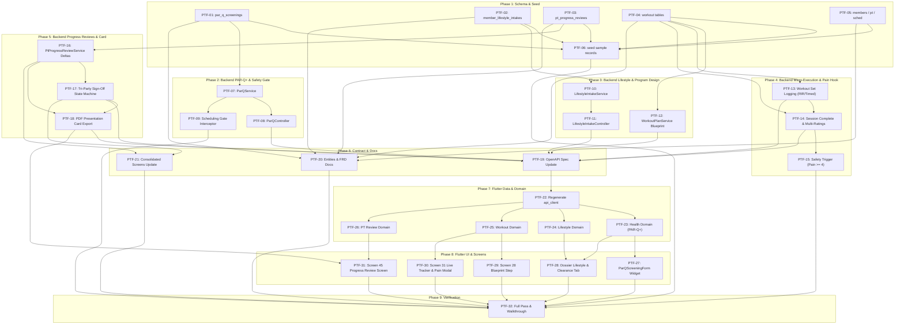

# Tasks Register: PT Client File Digitization & Missing Fields Integration

Derived from [PLAN.md](./PLAN.md).  
Source Document: [Luxe knox pt client  file.pdf](./Luxe%20knox%20pt%20client%20%20file.pdf)  

**Rule:** each task touches at most 7 files, not counting generated code.  
**Status values:** `blocked` · `pending` · `in-progress` · `review` · `completed`  

32 tasks across 9 phases. The app is in active development, so schema updates are edited cleanly in place and tested against the local environment.

---

## Checklist

**Phase 1: Schema and Seed**
- [x] PTF-01 Drizzle schema: create `par_q_screenings` table <!-- id: 1 -->
- [x] PTF-02 Drizzle schema: create `member_lifestyle_intakes` table <!-- id: 2 -->
- [x] PTF-03 Drizzle schema: create `pt_progress_reviews` table <!-- id: 3 -->
- [x] PTF-04 Drizzle schema: alter `workout_plans`, `workout_plan_exercises`, `workout_sessions`, `workout_session_exercises` <!-- id: 4 -->
- [x] PTF-05 Drizzle schema: alter `members`, `pt_subscription_changes`, `schedule_participants` <!-- id: 5 -->
- [x] PTF-06 Seed sample PAR-Q+, lifestyle intake, and progress review records <!-- id: 6 -->

**Phase 2: Backend PAR-Q+ & Safety Gate**
- [x] PTF-07 `ParQService`: submit questionnaire, compute positive flag, handle doctor referral <!-- id: 7 -->
- [x] PTF-08 `ParQController` endpoints & DTO validation <!-- id: 8 -->
- [x] PTF-09 Scheduling gate interceptor: block PT booking when `pending_clearance` <!-- id: 9 -->

**Phase 3: Backend Lifestyle Intake & Macrocycle Program Design**
- [x] PTF-10 `LifestyleIntakeService`: upsert habits, stress (1–10), and 4 lifestyle priorities <!-- id: 10 -->
- [x] PTF-11 `LifestyleIntakeController` endpoints & DTOs <!-- id: 11 -->
- [x] PTF-12 Update `WorkoutPlanService` for 12w objective, 4w milestone, frequency, duration, split, progression methods <!-- id: 12 -->

**Phase 4: Backend Workout Micro-Execution & Pain Hook**
- [x] PTF-13 Workout set logging: RIR, timed duration seconds, exercise notes <!-- id: 13 -->
- [x] PTF-14 Session completion: multi-metric ratings (effort, satisfaction, pain 0–10) & next-session plan <!-- id: 14 -->
- [x] PTF-15 Automated safety trigger: log medical alert if `pain_discomfort_score >= 4` <!-- id: 15 -->

**Phase 5: Backend PT Progress Reviews & Presentation Card**
- [x] PTF-16 `PtProgressReviewService`: create draft, auto-calculate deltas (start vs current vs target) <!-- id: 16 -->
- [x] PTF-17 Review tri-party sign-off state machine (Trainer $\rightarrow$ Client $\rightarrow$ Manager) <!-- id: 17 -->
- [x] PTF-18 Presentation Card PDF export endpoint (matching Page 8 layout) <!-- id: 18 -->

**Phase 6: Contract and Docs**
- [x] PTF-19 Update `docs/openapi/v1.yaml` with all new schemas and paths <!-- id: 19 -->
- [x] PTF-20 Update `docs/database-entities.md` and `docs/backend-frd.md` <!-- id: 20 -->
- [x] PTF-21 Update `docs/screens/consolidated-screens.md` with Screen 45 <!-- id: 21 -->

**Phase 7: Flutter Data & Domain**
- [x] PTF-22 Regenerate `packages/api_client` from updated OpenAPI spec <!-- id: 22 -->
- [x] PTF-23 Health domain: PAR-Q+ entities, repositories, and use cases <!-- id: 23 -->
- [x] PTF-24 Lifestyle domain: lifestyle intake entities, repositories, and use cases <!-- id: 24 -->
- [x] PTF-25 Workout domain: update workout plan, session, and set entities for RIR/Pain/Blueprint <!-- id: 25 -->
- [x] PTF-26 PT Review domain: progress review entity, repository, and use cases <!-- id: 26 -->

**Phase 8: Flutter UI & Screens**
- [x] PTF-27 Member Onboarding / Screen 04: `ParQScreeningForm` & touch signature <!-- id: 27 -->
- [x] PTF-28 Member Dossier: Health Clearance badge & "Lifestyle & Habits" consultation tab <!-- id: 28 -->
- [x] PTF-29 Screen 28 (`WorkoutPlanBuilder`): Macrocycle Blueprint form step <!-- id: 29 -->
- [ ] PTF-30 Screen 31 (`LiveWorkoutSessionTracker`): RIR stepper, timed sets stopwatch, Post-Workout Rating modal <!-- id: 30 -->
- [ ] PTF-31 Screen 45 (`PtProgressReviewScreen`): Review Card, delta table, badges, 3-way sign-off, PDF export <!-- id: 31 -->

**Phase 9: Verification**
- [ ] PTF-32 Full automated test suite passes (`api:test`, `flutter test`, `openapi:check`) & manual walkthrough <!-- id: 32 -->

---

## Dependency Graph

### Task Dependency Matrix

| Task ID | Task Description | Direct Dependencies (Prerequisites) |
| :--- | :--- | :--- |
| **PTF-01** | Drizzle schema: create `par_q_screenings` table | *None* (initial schema definition) |
| **PTF-02** | Drizzle schema: create `member_lifestyle_intakes` table | *None* (initial schema definition) |
| **PTF-03** | Drizzle schema: create `pt_progress_reviews` table | *None* (initial schema definition) |
| **PTF-04** | Drizzle schema: alter workout tables | *None* (initial schema definition) |
| **PTF-05** | Drizzle schema: alter members, PT changes, schedule participants | *None* (initial schema definition) |
| **PTF-06** | Seed sample records | **PTF-01**, **PTF-02**, **PTF-03**, **PTF-04**, **PTF-05** |
| **PTF-07** | `ParQService` core logic | **PTF-01** |
| **PTF-08** | `ParQController` endpoints & DTO validation | **PTF-07** |
| **PTF-09** | Scheduling gate interceptor | **PTF-07** |
| **PTF-10** | `LifestyleIntakeService` | **PTF-02** |
| **PTF-11** | `LifestyleIntakeController` endpoints & DTOs | **PTF-10** |
| **PTF-12** | Update `WorkoutPlanService` for Macrocycle Blueprint | **PTF-04** |
| **PTF-13** | Workout set logging enhancements (RIR & Timed sets) | **PTF-04** |
| **PTF-14** | Session completion with multi-metric ratings | **PTF-04**, **PTF-13** |
| **PTF-15** | Automated safety trigger for high pain scores | **PTF-14** |
| **PTF-16** | `PtProgressReviewService` drafting & auto-deltas | **PTF-03** |
| **PTF-17** | Review tri-party sign-off state machine | **PTF-16** |
| **PTF-18** | Presentation Card PDF export endpoint | **PTF-16**, **PTF-17** |
| **PTF-19** | Update OpenAPI specification | **PTF-08**, **PTF-11**, **PTF-12**, **PTF-13**, **PTF-14**, **PTF-17**, **PTF-18** |
| **PTF-20** | Update database entities & backend FRD docs | **PTF-01**, **PTF-02**, **PTF-03**, **PTF-04**, **PTF-05** |
| **PTF-21** | Update consolidated screens matrix | **PTF-16**, **PTF-17** |
| **PTF-22** | Regenerate API client | **PTF-19** |
| **PTF-23** | Health domain (PAR-Q+) | **PTF-22** |
| **PTF-24** | Lifestyle intake domain | **PTF-22** |
| **PTF-25** | Workout domain updates | **PTF-22** |
| **PTF-26** | PT Review domain | **PTF-22** |
| **PTF-27** | `ParQScreeningForm` widget & signature dialog | **PTF-23** |
| **PTF-28** | Member Dossier Health Clearance & Lifestyle tab | **PTF-23**, **PTF-24** |
| **PTF-29** | Macrocycle Blueprint step in `WorkoutPlanBuilder` | **PTF-25** |
| **PTF-30** | Live Tracker RIR, Timed Sets & Post-Workout Feedback Modal | **PTF-25** |
| **PTF-31** | Build Screen 45 (`PtProgressReviewScreen`) | **PTF-26**, **PTF-18** |
| **PTF-32** | Full automated pass & manual walkthrough | **PTF-06**, **PTF-09**, **PTF-15**, **PTF-20**, **PTF-21**, **PTF-27**, **PTF-28**, **PTF-29**, **PTF-30**, **PTF-31** |

---

## Detailed Task Specifications

### Phase 1: Schema and Seed

#### PTF-01: Drizzle schema: create `par_q_screenings` table
* **Files:** `apps/api/src/platform/db/schema/health.ts`, `apps/api/drizzle/`
* **Dependencies:** None
* **Changes:** Add `par_q_screenings` table with columns: `id`, `member_id`, `version`, `q1_heart_condition`..`q7_other_reason` (booleans + details text), `has_positive_answer`, `trainer_screening_notes`, `referral_required`, `referral_reason`, `declaration_accepted`, `client_signed_at`, `trainer_signed_at`, `clearance_status`, `cleared_at`, `cleared_by_user_id`.
* **Done criteria:** Table compiles cleanly in TypeScript; foreign keys to `members` and `users` validated.

#### PTF-02: Drizzle schema: create `member_lifestyle_intakes` table
* **Files:** `apps/api/src/platform/db/schema/health.ts`
* **Dependencies:** None
* **Changes:** Add `member_lifestyle_intakes` table: `id`, `member_id`, `activity_level`, `training_history`, `current_pain_discomfort`, `sleep_hours_typical`, `stress_level`, `work_activity_demands`, `typical_daily_steps`, `hydration_habits`, `recovery_habits`, `other_notes`, `lifestyle_priorities` JSON.
* **Done criteria:** Unique constraint on `member_id` verified.

#### PTF-03: Drizzle schema: create `pt_progress_reviews` table
* **Files:** `apps/api/src/platform/db/schema/pt.ts`
* **Dependencies:** None
* **Changes:** Add `pt_progress_reviews` table: `id`, `member_id`, `trainer_id`, `review_period_start`, `review_period_end`, `body_metrics_snapshot` JSON, `performance_markers_snapshot` JSON, `progress_highlights` JSON, `trainer_summary`, `client_feedback`, `next_phase_goal`, `next_phase_training_focus`, `next_review_date`, `review_checklist` JSON, `final_review_notes`, `client_signed_at`, `trainer_signed_at`, `manager_user_id`, `manager_signed_at`, `status`.
* **Done criteria:** Table created with indices on `member_id` and `trainer_id`.

#### PTF-04: Drizzle schema: alter workout tables
* **Files:** `apps/api/src/platform/db/schema/workout.ts`
* **Dependencies:** None
* **Changes:**
  * `workout_plans`: add `primary_objective_12w`, `milestone_4w`, `sessions_per_week`, `target_session_duration_minutes`, `split_type`, `cardio_protocol`, `mobility_protocol`, `progression_methods`, `main_success_measure`.
  * `workout_plan_exercises`: add `target_rir`, `target_duration_seconds`, `notes`.
  * `workout_sessions`: add `session_focus`, `warmup_protocol`, `cooldown_protocol`, `effort_rating`, `satisfaction_rating`, `pain_discomfort_score`, `pain_notes`, `next_session_plan`, `client_signed_at`, `trainer_signed_at`.
  * `workout_session_exercises`: add `actual_rir`, `actual_duration_seconds`, `notes`.
* **Done criteria:** Columns compile and pass `pnpm --filter api db:check`.

#### PTF-05: Drizzle schema: alter members, PT changes, schedule participants
* **Files:** `apps/api/src/platform/db/schema/members.ts`, `apps/api/src/platform/db/schema/pt.ts`, `apps/api/src/platform/db/schema/scheduling.ts`
* **Dependencies:** None
* **Changes:**
  * `members`: add `next_review_date`, `preferred_training_days_times`, `exercise_preferences`, `coaching_notes`.
  * `pt_subscription_changes`: add `handover_continuity_notes`.
  * `schedule_participants`: add `client_verified_at`.
* **Done criteria:** TypeScript schema types reflect new columns.

#### PTF-06: Seed sample records
* **Files:** `apps/api/src/platform/db/seed/`
* **Dependencies:** PTF-01, PTF-02, PTF-03, PTF-04, PTF-05
* **Changes:** Seed sample PAR-Q+ questionnaire with negative responses, sample lifestyle intake, and sample progress review for test members.
* **Done criteria:** `pnpm api:seed` completes without error.

---

### Phase 2: Backend PAR-Q+ & Safety Gate

#### PTF-07: `ParQService` core logic
* **Files:** `apps/api/src/health/par-q.service.ts`, `apps/api/src/health/par-q.service.spec.ts`
* **Dependencies:** PTF-01
* **Changes:** Implement submission logic. Compute `has_positive_answer` automatically. If true, set `clearance_status = 'pending_clearance'`, else `'passed'`. Implement trainer review and admin clearance approval methods.
* **Done criteria:** Unit tests pass for both all-negative and positive answer scenarios.

#### PTF-08: `ParQController` endpoints & DTO validation
* **Files:** `apps/api/src/health/par-q.controller.ts`, `apps/api/src/health/dto/par-q.dto.ts`
* **Dependencies:** PTF-07
* **Changes:** Expose `POST /api/v1/members/:id/par-q`, `PATCH /api/v1/members/:id/par-q/trainer-review`, and `POST /api/v1/members/:id/par-q/clearance` with class-validator decorators.
* **Done criteria:** Endpoints return expected 201/200 responses with validated payloads.

#### PTF-09: Scheduling gate interceptor
* **Files:** `apps/api/src/sched/scheduling.service.ts`, `apps/api/src/sched/scheduling.service.spec.ts`
* **Dependencies:** PTF-07
* **Changes:** Check `par_q_screenings.clearance_status` when booking or starting PT sessions. If `'pending_clearance'`, reject with `BusinessRuleError('MEDICAL_CLEARANCE_REQUIRED')`.
* **Done criteria:** Unit test confirms booking is blocked when clearance is pending.

---

### Phase 3: Backend Lifestyle Intake & Macrocycle Program Design

#### PTF-10: `LifestyleIntakeService`
* **Files:** `apps/api/src/people/lifestyle-intake.service.ts`, `apps/api/src/people/lifestyle-intake.service.spec.ts`
* **Dependencies:** PTF-02
* **Changes:** Implement upsert and fetch logic for lifestyle intake profile, habit strings, stress score, and the 4 lifestyle priorities matrix.
* **Done criteria:** Upsert updates existing member record cleanly.

#### PTF-11: `LifestyleIntakeController`
* **Files:** `apps/api/src/people/lifestyle-intake.controller.ts`, `apps/api/src/people/dto/lifestyle-intake.dto.ts`
* **Dependencies:** PTF-10
* **Changes:** Expose `GET /api/v1/members/:id/lifestyle-intake` and `PUT /api/v1/members/:id/lifestyle-intake`.
* **Done criteria:** Validation ensures stress is 1–10 and priorities array contains required 4 domains.

#### PTF-12: Update `WorkoutPlanService` for Macrocycle Blueprint
* **Files:** `apps/api/src/work/workout-plan.service.ts`, `apps/api/src/work/dto/workout-plan.dto.ts`
* **Dependencies:** PTF-04
* **Changes:** Extend create/update DTOs with 12w objective, 4w milestone, sessions per week, target duration, split, and progression levers.
* **Done criteria:** Workout plan creation persists all blueprint fields.

---

### Phase 4: Backend Workout Micro-Execution & Pain Hook

#### PTF-13: Workout set logging enhancements (RIR & Timed sets)
* **Files:** `apps/api/src/work/workout-session.service.ts`, `apps/api/src/work/dto/workout-session.dto.ts`
* **Dependencies:** PTF-04
* **Changes:** Accept `target_rir`, `actual_rir`, `target_duration_seconds`, `actual_duration_seconds`, and set `notes`.
* **Done criteria:** Set execution supports both rep counts and second durations.

#### PTF-14: Session completion with multi-metric ratings
* **Files:** `apps/api/src/work/workout-session.service.ts`, `apps/api/src/work/workout-session.controller.ts`
* **Dependencies:** PTF-04, PTF-13
* **Changes:** Update `completeSession`: accept `effort_rating` (1–10), `satisfaction_rating` (1–10), `pain_discomfort_score` (0–10), `pain_notes`, and `next_session_plan`.
* **Done criteria:** Session completion records all rating dimensions and timestamps client/trainer sign-offs.

#### PTF-15: Automated safety trigger for high pain scores
* **Files:** `apps/api/src/work/workout-session.service.ts`
* **Dependencies:** PTF-14
* **Changes:** When `pain_discomfort_score >= 4`, automatically append an active discomfort record in `medical_histories` and dispatch a high-priority alert notification to the assigned trainer and head coach.
* **Done criteria:** Unit test verifies medical history row is inserted upon high pain score.

---

### Phase 5: Backend PT Progress Reviews & Presentation Card

#### PTF-16: `PtProgressReviewService` drafting & auto-deltas
* **Files:** `apps/api/src/pt/pt-progress-review.service.ts`, `apps/api/src/pt/pt-progress-review.service.spec.ts`
* **Dependencies:** PTF-03
* **Changes:** Implement draft review generation. Automatically load client's baseline measurements and current measurements, calculate delta changes (`current - start`), and snapshot values into `body_metrics_snapshot`.
* **Done criteria:** Calculated changes match expected mathematical differences.

#### PTF-17: Review tri-party sign-off state machine
* **Files:** `apps/api/src/pt/pt-progress-review.service.ts`, `apps/api/src/pt/pt-progress-review.controller.ts`
* **Dependencies:** PTF-16
* **Changes:** Endpoints for `PATCH /reviews/:id/client-sign` (sets `client_signed_at`, moves status to `pending_manager_approval`) and `PATCH /reviews/:id/manager-approve` (sets `manager_signed_at`, moves status to `approved`).
* **Done criteria:** State transitions enforce correct role permissions at each stage.

#### PTF-18: Presentation Card PDF export endpoint
* **Files:** `apps/api/src/pt/pt-progress-review-pdf.service.ts`, `apps/api/src/pt/pt-progress-review.controller.ts`
* **Dependencies:** PTF-16, PTF-17
* **Changes:** Implement `GET /reviews/:id/export-pdf` using PDF generator to format Page 8 presentation card (measures table, highlights, next phase, signatures).
* **Done criteria:** Returns valid `application/pdf` buffer.

---

### Phase 6: Contract and Docs

#### PTF-19: Update OpenAPI specification
* **Files:** `docs/openapi/v1.yaml`
* **Dependencies:** PTF-08, PTF-11, PTF-12, PTF-13, PTF-14, PTF-17, PTF-18
* **Changes:** Add all new schemas (`ParQScreening`, `LifestyleIntake`, `PtProgressReview`, updated Workout schemas) and endpoints.
* **Done criteria:** `pnpm --filter api openapi:check` passes without discrepancies.

#### PTF-20: Update database entities & backend FRD docs
* **Files:** `docs/database-entities.md`, `docs/backend-frd.md`
* **Dependencies:** PTF-01, PTF-02, PTF-03, PTF-04, PTF-05
* **Changes:** Add sections for `par_q_screenings`, `member_lifestyle_intakes`, `pt_progress_reviews` and update existing entity attributes.
* **Done criteria:** Documentation matches actual Drizzle schema.

#### PTF-21: Update consolidated screens matrix
* **Files:** `docs/screens/consolidated-screens.md`
* **Dependencies:** PTF-16, PTF-17
* **Changes:** Add **Screen 45: `PtProgressReviewScreen`** with Member, Trainer, and Admin role variations.
* **Done criteria:** Screen matrix reflects 45 unified screens.

---

### Phase 7: Flutter Data & Domain

#### PTF-22: Regenerate API client
* **Files:** `packages/api_client/`
* **Dependencies:** PTF-19
* **Changes:** Run OpenAPI generator to create Dart models and API classes for all new endpoints.
* **Done criteria:** `dart analyze packages/api_client` passes with zero errors.

#### PTF-23: Health domain (PAR-Q+)
* **Files:** `app/lib/features/people/domain/entities/`, `app/lib/features/people/data/repositories/`
* **Dependencies:** PTF-22
* **Changes:** Implement `ParQScreening` entity, repository contract, and implementation calling generated client.
* **Done criteria:** Unit tests pass for PAR-Q repository.

#### PTF-24: Lifestyle intake domain
* **Files:** `app/lib/features/people/domain/entities/lifestyle_intake.dart`, `app/lib/features/people/data/`
* **Dependencies:** PTF-22
* **Changes:** Implement `LifestyleIntake` entity, repository, and use cases (`GetLifestyleIntakeUseCase`, `SaveLifestyleIntakeUseCase`).
* **Done criteria:** Entity serialization and repository mapping tested.

#### PTF-25: Workout domain updates
* **Files:** `app/lib/features/workout/domain/entities/`, `app/lib/features/workout/data/models/`
* **Dependencies:** PTF-22
* **Changes:** Update workout plan, workout session, and exercise set entities with RIR, timed duration, and multi-dimensional feedback ratings.
* **Done criteria:** Domain entities handle new fields gracefully.

#### PTF-26: PT Progress Review domain
* **Files:** `app/lib/features/pt/domain/entities/pt_progress_review.dart`, `app/lib/features/pt/data/`
* **Dependencies:** PTF-22
* **Changes:** Implement `PtProgressReview` entity, `PtProgressReviewRepository`, and use cases for drafting, signing, and exporting reviews.
* **Done criteria:** Domain tests pass.

---

### Phase 8: Flutter UI & Screens

#### PTF-27: `ParQScreeningForm` widget & signature dialog
* **Files:** `app/lib/features/people/presentation/widgets/par_q_screening_form.dart`, `app/lib/features/people/presentation/screens/`
* **Dependencies:** PTF-23
* **Changes:** Create form with 7 questions, expandable detail text fields on YES, legal declaration checkbox, and touch signature canvas.
* **Done criteria:** Form validates correctly and posts to API.

#### PTF-28: Member Dossier Health Clearance & Lifestyle tab
* **Files:** `app/lib/features/people/presentation/screens/member_dossier_screen.dart`, `app/lib/features/people/presentation/widgets/`
* **Dependencies:** PTF-23, PTF-24
* **Changes:**
  * Add Health Clearance Status banner (Green / Red pending clearance).
  * Add "Lifestyle & Habits" tab rendering stress score, sleep, and the 4-quadrant priorities matrix with action badges.
* **Done criteria:** Displays live lifestyle data and clearance status for assigned clients.

#### PTF-29: Macrocycle Blueprint step in `WorkoutPlanBuilder`
* **Files:** `app/lib/features/workout/presentation/screens/workout_plan_builder_screen.dart`
* **Dependencies:** PTF-25
* **Changes:** Add Step 1 "Program Blueprint": 12-week objective, 4-week milestone, frequency stepper, duration, split selector, and progression method checkboxes.
* **Done criteria:** Step 1 validates before proceeding to exercise selection.

#### PTF-30: Live Tracker RIR, Timed Sets & Post-Workout Feedback Modal
* **Files:** `app/lib/features/workout/presentation/screens/live_workout_session_screen.dart`, `app/lib/features/workout/presentation/widgets/`
* **Dependencies:** PTF-25
* **Changes:**
  * Add RIR stepper and stopwatch duration mode toggle per set.
  * Add completion modal with Sliders for Effort (1–10), Satisfaction (1–10), and Pain / Discomfort (0–10).
  * If pain score $> 0$, prompt for pain notes.
* **Done criteria:** Completing workout submits multi-rating payload and triggers alerts when appropriate.

#### PTF-31: Build Screen 45 (`PtProgressReviewScreen`)
* **Files:** `app/lib/features/pt/presentation/screens/pt_progress_review_screen.dart`, `app/lib/features/pt/presentation/widgets/`
* **Dependencies:** PTF-26, PTF-18
* **Changes:**
  * Render Measures Comparison Table (Start vs Current vs Change vs Target).
  * Render Celebration Highlight Chips.
  * Render 6-item checklist and Next Phase Roadmap.
  * Implement Tri-Party Signature Tracker (Trainer, Client, Manager).
  * Add "Export PDF Presentation Card" button.
* **Done criteria:** Full review lifecycle (draft $\rightarrow$ client sign $\rightarrow$ manager approve $\rightarrow$ export) functions end-to-end.

---

### Phase 9: Verification

#### PTF-32: Full automated pass & manual walkthrough
* **Files:** Entire repo
* **Dependencies:** PTF-06, PTF-09, PTF-15, PTF-20, PTF-21, PTF-27, PTF-28, PTF-29, PTF-30, PTF-31
* **Verification:**
  1. `pnpm --filter api test` passes all tests.
  2. `pnpm --filter api openapi:check` passes.
  3. `flutter analyze` passes with 0 errors.
  4. `flutter test` passes across `people`, `pt`, and `workout` features.
  5. Manual walkthrough on Flutter Web/Desktop confirming PAR-Q+ gate, lifestyle intake, workout rating with pain score, and progress review sign-off.
* **Done criteria:** All 32 tasks completed and checked off.
